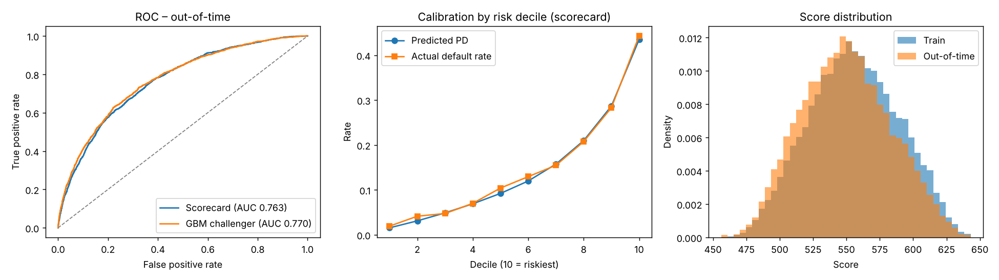

# Credit Risk Scoring: WoE Scorecard + Monotonic GBM

A probability-of-default (PD) model for consumer loans, built the way regulated lenders build them:
an interpretable **Weight-of-Evidence logistic-regression scorecard** as the champion, a
**monotonic gradient-boosting** challenger, **out-of-time validation**, **PSI monitoring**, and
**adverse-action reason codes** for declined applicants (ECOA / Regulation B).

**[Live demo: Loan Scorecard Studio](https://martinogie.github.io/credit-risk-scoring/)**: change an
applicant's credit file and watch the score, PD, decision band and reason codes update.



## Results (out-of-time, loans issued Jul–Dec 2024)

| Model | AUC | Gini | KS | Brier |
|---|---|---|---|---|
| WoE scorecard (champion) | 0.763 | 0.527 | 0.389 | 0.1111 |
| Monotonic GBM (challenger) | 0.770 | 0.540 | 0.408 | 0.1092 |

- Train: 45,016 loans (12.7% default rate) · Out-of-time: 14,984 loans (15.0%)
- Score PSI, development vs. out-of-time: **0.031** (stable < 0.10)
- The challenger gains only ~1.3 Gini points over the scorecard, so the
  scorecard stays champion: nearly the same accuracy, fully explainable, and simple to validate.

## What's inside

| Step | Where | Notes |
|---|---|---|
| Data | `credit_risk/data.py` | Synthetic loan book (60k loans, 2023–2024) or your own CSV |
| Binning | `credit_risk/binning.py` | Quantile pre-bins, merges until bad rate is **monotone** in the expected direction; WoE and IV |
| Scorecard | `credit_risk/scorecard.py` | Logistic regression on WoE; points scaled to 600 at 50:1 odds, PDO 20; reason codes |
| Challenger | `credit_risk/challenger.py` | `HistGradientBoostingClassifier` with monotonic constraints; permutation importance |
| Metrics | `credit_risk/metrics.py` | AUC, Gini, KS, Brier, PSI, decile calibration |
| Pipeline | `credit_risk/train.py` | Out-of-time split → fit → report, plots and artifacts in `reports/` |
| Scoring | `credit_risk/score.py` | Score one applicant from JSON and return reasons |
| Tests | `tests/` | Monotonicity, OOT split, points ↔ PD consistency, reason codes, PSI |
| Demo | `web/`, `docs/` | Static scoring page generated from `reports/scorecard.json`; `docs/` is served by GitHub Pages |

Feature selection keeps attributes with IV ≥ 0.02. Selected: fico, annual_income, dti, revolving_util, inquiries_6m, delinq_2yrs, term.

## Quick start

```bash
pip install -r requirements.txt
python -m credit_risk.train            # trains on synthetic data, writes reports/
python -m unittest discover -s tests   # 9 tests
python -m credit_risk.score --applicant '{"fico": 662, "annual_income": 48000, "dti": 31, "revolving_util": 78, "inquiries_6m": 3, "delinq_2yrs": 1, "emp_length_yrs": 2, "loan_amount": 18000, "open_accounts": 9, "term": "60 months", "home_ownership": "RENT", "purpose": "debt_consolidation"}'
python web/build.py                    # refresh the demo page from the new model
```

Example output: score 474, PD 61.5%, top reasons: credit score lower than preferred (−59.6 pts),
debt-to-income too high (−36.5), revolving utilization too high (−27.2), income insufficient (−15.3).

## Using real data

Train on any loan-level file with these columns: `fico, annual_income, dti, revolving_util,
inquiries_6m, delinq_2yrs, emp_length_yrs, loan_amount, open_accounts, term, home_ownership,
purpose, issue_date, default`. For LendingClub data, map `fico_range_low → fico`,
`annual_inc → annual_income`, `revol_util → revolving_util`, `inq_last_6mths → inquiries_6m`,
`delinq_2yrs`, `emp_length → emp_length_yrs`, `loan_amnt → loan_amount`, `open_acc`, `term`,
`home_ownership`, `purpose`, `issue_d → issue_date`, and set `default = 1` for Charged Off / Default.

```bash
python -m credit_risk.train --csv loans.csv --cutoff 2018-01-01
```

## Data note

The bundled data is **synthetic**. It mirrors the structure and risk relationships of public
consumer-lending data, adds unexplained noise so accuracy is realistic, and drifts the applicant mix
riskier over time so the monitoring has something to detect. Because the true risk drivers are
known, you can check that the model recovers them.

## Model governance notes

- **Explainability:** every score decomposes into points per attribute; reason codes rank attributes
  by points lost against their best bin.
- **Monotonicity:** bad rates and points move in the business-expected direction (tested).
- **Validation:** out-of-time holdout, decile calibration (`reports/oot_decile_calibration.csv`),
  champion/challenger comparison, and monthly PSI (`reports/oot_monthly_monitoring.csv`).
- **Documentation:** `reports/MODEL_REPORT.md` is generated on every run.

## How this was built

Built with AI-assisted coding (Claude). Modeling choices, validation and review are my own.

## License

MIT
