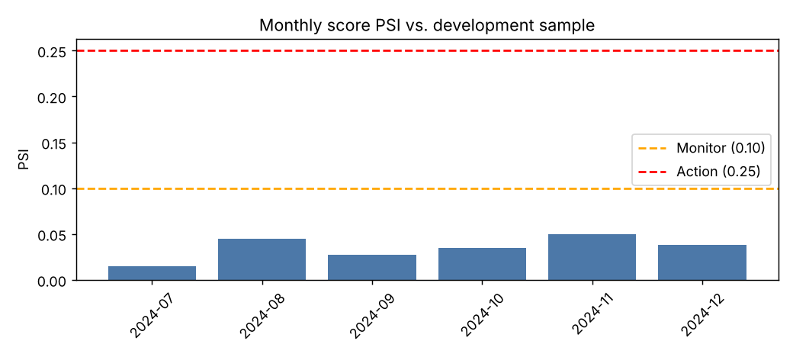

# Model Development Report – Consumer Loan PD

Data: **synthetic** · train 45,016 loans (default rate 12.7%) · out-of-time 14,984 loans (default rate 15.0%), split at 2024-07-01.

## Out-of-time performance

| Model | AUC | Gini | KS | Brier |
|---|---|---|---|---|
| WoE scorecard (champion) | 0.763 | 0.527 | 0.389 | 0.1111 |
| Monotonic GBM (challenger) | 0.770 | 0.540 | 0.408 | 0.1092 |

## Stability

Score PSI (train vs. out-of-time): **0.031** (stable).

## Selected features (Information Value)

| Feature | IV |
|---|---|
| fico | 0.838 |
| revolving_util | 0.214 |
| dti | 0.183 |
| inquiries_6m | 0.178 |
| delinq_2yrs | 0.107 |
| annual_income | 0.035 |
| term | 0.026 |

Full points table: `scorecard_table.csv`. Scale: 600 points at 50:1 good:bad odds, 20 points to double the odds.